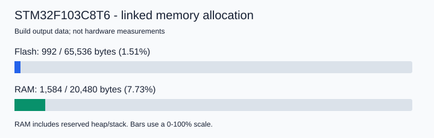

# 01_빌드 환경 검증

검증일: 2026-10-15 (한국 시간).
대상: Build.

## 조건과 판정 기준

Windows에서 STM32CubeIDE 1.15.0의 GNU Arm GCC 12.3.rel1 및 GNU make로
Debug를 정리한 뒤 Tools/build.ps1로 전체 빌드했다.
종료 코드 0, 경고/오류 없음, ELF/BIN/MAP/LIST 생성,
Flash 64 KB와 RAM 20 KB 이내, 벡터 주소 0x08000000을 통과 기준으로 삼았다.

| 항목 | 결과 | 근거 |
|---|---|---|
| 전체 빌드 | 통과 | clean 후 빌드 종료 코드 0 |
| 컴파일 경고/오류 | 통과 | 빌드 로그에서 warning:/error: 없음 |
| 산출물 | 통과 | ELF/BIN/MAP/LIST 생성 |
| Flash 한도 | 통과 | text 980 + data 12 = 992 / 65536 바이트 |
| RAM 한도 | 통과 | data 12 + bss 1572 = 1584 / 20480 바이트 |
| 벡터 테이블 | 통과 | ELF .isr_vector VMA/LMA 0x08000000 |
| 코드 공백 검사 | 통과 | git diff --check |
| ST-LINK 다운로드 | 미검증 | 보드 기록 작업 미실행 |
| 보드 실행/HSI/SysTick | 미검증 | 실측 및 시뮬레이터 실행 미실행 |

RAM 수치는 링크 시 예약된 힙 512바이트·스택 1024바이트와 정렬을 포함한다.
실행 중 스택 최고 사용량이나 실제 힙 사용량을 뜻하지 않는다.

데이터 출처: Debug/default.size.stdout, Debug/stm32f103c8t6.map,
Debug/stm32f103c8t6.list, Debug/build-validation.log.
빌드 산출물은 Git에서 제외한다. 아래 그래프는 위 링크 결과를 용량으로 나눈
계산값이며 보드 실측 또는 시뮬레이션 값이 아니다.

